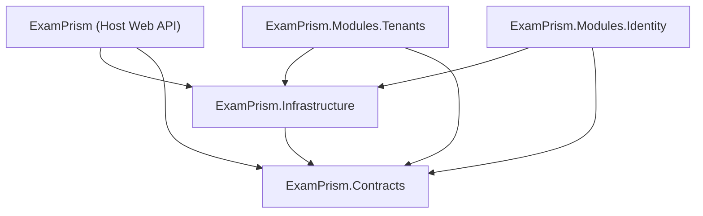
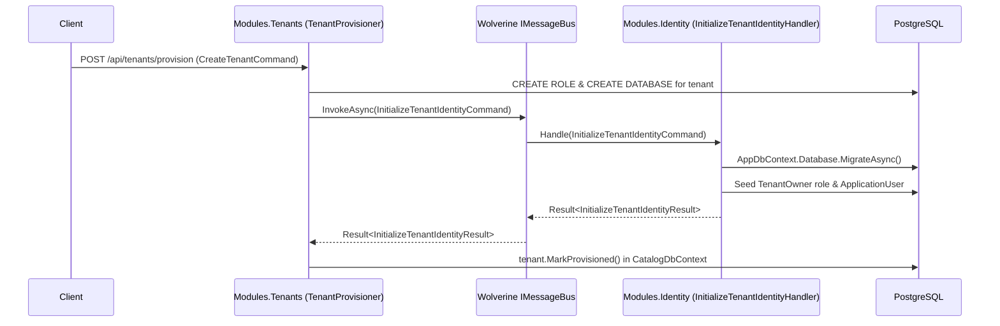

# Modular Monolith Architecture & Dynamic Module Loading — Design Specification

**Date:** 2026-11-06
**Status:** Draft for Review
**Scope:** Sub-project 1 of 3 (Modular Monolith DLL Extraction, `IModule` Contract, Dynamic Plugin Loading, and Message-Based Inter-Module Communication)

---

## 1. Context & Multi-Phase Roadmap

`ExamPrism` is transitioning from a single-project backend (`apps/backend/src/ExamPrism.csproj`) to a **Modular Monolith** architecture where each domain module is compiled into its own `.dll`, discovers and registers itself dynamically at startup via a shared `IModule` contract, owns its own `DbContext` and EF Core migrations, and communicates with other modules exclusively via messages/events rather than shared service interfaces.

To keep each iteration focused and verifiable, the broader architectural vision is decomposed into three sequential sub-projects:

1. **Sub-project 1 (This Spec):** Extract `ExamPrism.Contracts`, `ExamPrism.Infrastructure`, `ExamPrism.Modules.Tenants`, and `ExamPrism.Modules.Identity` under `apps/backend/src/`; implement `IModule` dynamic assembly scanning and configuration loading in the Host (`ExamPrism`); decouple `Tenants` and `Identity` persistence and replace direct cross-module calls with Wolverine `IMessageBus` message contracts.
2. **Sub-project 2 (Future Spec):** Introduce **RabbitMQ** transport and **Wolverine Saga Pattern** to orchestrate multi-step cross-module workflows (such as asynchronous tenant provisioning and compensating actions).
3. **Sub-project 3 (Future Spec):** Introduce **Database Replica** read/write splitting across module data sources.

---

## 2. Goals & Non-Goals (Sub-project 1)

### Goals
- Define `IModule` in a dedicated contract assembly (`ExamPrism.Contracts.dll`).
- Extract shared technical infrastructure into `ExamPrism.Infrastructure.dll`.
- Extract two strictly isolated domain modules into separate class library assemblies:
  - `ExamPrism.Modules.Tenants.dll` (owns `Tenant`, `PlatformUser`, `PlatformRole`, `PlatformRefreshToken`, `CatalogDbContext`, Catalog migrations, and `/api/tenants/*` + `/api/platform/*` features/endpoints).
  - `ExamPrism.Modules.Identity.dll` (owns `ApplicationUser`, `RefreshToken`, `AppDbContext`, Tenant migrations, and `/api/auth/*` features/endpoints).
- Keep the Host project (`ExamPrism.dll`) free of compile-time `<ProjectReference>` dependencies on module projects, discovering `IModule` implementations dynamically from `.dll` files in `AppContext.BaseDirectory`.
- Automatically load each module's `ModuleSettingFiles` into `builder.Configuration` before invoking `module.ConfigureServices(builder)`, and auto-register Wolverine handlers, FluentValidation validators, and `IEndpoint` routes for all discovered module assemblies.
- Ensure zero shared service interfaces or direct references between `Modules.Tenants` and `Modules.Identity`; all cross-module operations (tenant identity database migration and initial owner seeding) execute over `IMessageBus` using pure message records in `ExamPrism.Contracts`.

### Non-Goals
- Setting up RabbitMQ containers, broker topologies, or persistent stateful Saga tables (deferred to Sub-project 2).
- Read-replica connection routing (deferred to Sub-project 3).

---

## 3. Solution Layout & Dependency Graph

All projects reside inside `apps/backend/src/` and are registered in `apps/backend/ExamPrism.slnx`:

```text
apps/backend/
├── ExamPrism.slnx
├── Directory.Build.props
├── Directory.Packages.props
├── src/
│   ├── ExamPrism.Contracts/
│   │   └── ExamPrism.Contracts.csproj
│   ├── ExamPrism.Infrastructure/
│   │   └── ExamPrism.Infrastructure.csproj
│   ├── Modules/
│   │   ├── Tenants/
│   │   │   ├── ExamPrism.Modules.Tenants.csproj
│   │   │   └── appsettings.tenants.json
│   │   └── Identity/
│   │       ├── ExamPrism.Modules.Identity.csproj
│   │       └── appsettings.identity.json
│   └── ExamPrism/
│       ├── ExamPrism.csproj
│       ├── Program.cs
│       ├── appsettings.json
│       └── appsettings.Development.json
└── tests/
    └── ExamPrism.Tests/
        └── ExamPrism.Tests.csproj
```

### Compile-Time Dependency Rules



- `ExamPrism.Contracts` has **no** project references. It uses `<FrameworkReference Include="Microsoft.AspNetCore.App" />` so `IModule` and `IEndpoint` can reference `WebApplicationBuilder` and `IEndpointRouteBuilder`.
- `ExamPrism.Infrastructure` references **only** `ExamPrism.Contracts`.
- `ExamPrism.Modules.Tenants` references `ExamPrism.Contracts` and `ExamPrism.Infrastructure`. It **must not** reference `ExamPrism.Modules.Identity`.
- `ExamPrism.Modules.Identity` references `ExamPrism.Contracts` and `ExamPrism.Infrastructure`. It **must not** reference `ExamPrism.Modules.Tenants`.
- `ExamPrism` (Host) has compile-time `<ProjectReference>`s **only** to `ExamPrism.Contracts` and `ExamPrism.Infrastructure`.
  - To ensure MSBuild builds module projects before the Host and copies module `.dll`, `.pdb`, and `appsettings.*.json` files into the Host's output directory (`$(OutDir)`) without adding compile-time assembly references, `ExamPrism.csproj` uses `<ProjectReference Include="..\Modules\...\*.csproj" ReferenceOutputAssembly="false" CopyLocalSatelliteAssemblies="false" />` combined with an MSBuild target (`CopyModulePluginOutputs`) that copies each module's build output into `$(OutDir)`.

---

## 4. Component Design

### 4.1 `ExamPrism.Contracts`

Contains cross-cutting abstractions, primitives, and pure message contracts:

1. **Module Contract (`Common.Modules`):**
   ```csharp
   namespace Common.Modules;

   using Microsoft.AspNetCore.Builder;

   public interface IModule
   {
       string Name { get; }
       string[] ModuleSettingFiles { get; }
       void ConfigureServices(WebApplicationBuilder builder);
   }
   ```
   Also includes `IStartupInitializer` (`Task InitializeAsync(IServiceProvider services, CancellationToken ct = default)`) so modules can register startup tasks (such as platform admin seeding or stuck tenant recovery) into DI without Host coupling.

2. **Cross-Module Integration Messages (`Common.Messages.Tenants`):**
   Pure C# `record` messages sent over Wolverine `IMessageBus`:
   ```csharp
   namespace Common.Messages.Tenants;

   public sealed record InitializeTenantIdentityCommand(
       Guid TenantId,
       string TenantSlug,
       string RawConnectionString,
       string? OwnerEmail,
       string? EncryptedOwnerPassword);

   public sealed record InitializeTenantIdentityResult(bool Succeeded);

   public sealed record MigrateTenantDatabaseCommand(
       Guid TenantId,
       string TenantSlug,
       string RawConnectionString);

   public sealed record MigrateTenantDatabaseResult(int AppliedMigrationsCount);
   ```

3. **Existing `Common/*` Primitives:**
   - `Common.Domain` (`Entity<TId>`, `AggregateRoot<TId>`, `ValueObject`, `IDomainEvent`, `IAuditableEntity`, `Specifications/*`)
   - `Common.Results` (`Result`, `Result<T>`, `Error`, `ErrorType`)
   - `Common.Handlers` (`IHandler`, `IHandler<TRequest>`, `IHandler<TRequest, TResponse>`)
   - `Common.Endpoints` (`IEndpoint`, `EndpointExtensions`, `ResultExtensions`, `TenantEndpointExtensions`, `TenantProblemResults`)
   - `Common.Security` (`IUserContext`, `ITokenService`, `ITokenRevocationService`, `IIpReputationService`, `CustomClaimTypes`, `PlatformRoles`, `TenantRoles`)
   - `Common.MultiTenancy` (`ITenantContext`, `ITenantProvisioner`, `ITenantFleetMigrator`, `ITenantCacheInvalidator`, `IConnectionStringProtector`, `ITenantConnectionStringNormalizer`, `TenantStatus`, `TenantSlugValidator`)
   - `Common.Caching`, `Common.Locking`, `Common.Batching`, `Common.Orleans`, `Common.RateLimiting`, `Common.Resilience`, `Common.Validation`, `Common.Exceptions`, `Common.Localization`, `Common.Telemetry`, `Common.Http`, `Common.Idempotency`, `Common.Persistence.IDbQuery`
   - Note: `IAppDbContext` and `ICatalogDbContext` are removed from `ExamPrism.Contracts` because each module encapsulates its own `DbContext` and domain entities.

---

### 4.2 `ExamPrism.Infrastructure` & Dynamic `ModuleLoader`

Contains shared technical plumbing and the dynamic module loader:

1. **`ModuleRegistry` & `ModuleLoader` (`ExamPrism.Infrastructure.Modules`):**
   - `ModuleRegistry`: Holds `IReadOnlyList<IModule> Modules` and `IReadOnlyList<Assembly> ModuleAssemblies`.
   - Discovery flow (`builder.AddModules()`):
     1. Enumerates `ExamPrism.Modules.*.dll` in `AppContext.BaseDirectory`.
     2. Loads each assembly via `AssemblyLoadContext.Default.LoadFromAssemblyPath(dllPath)` if not already loaded in `AppDomain.CurrentDomain`.
     3. Scans loaded assemblies for concrete, non-abstract, public types implementing `IModule`, instantiates them via `Activator.CreateInstance`, and orders them by `Name` (`StringComparer.OrdinalIgnoreCase`).
     4. Validates that all discovered modules have non-empty, unique `Name` values; throws `InvalidOperationException` on duplicate names.
     5. For each module and each file name in `module.ModuleSettingFiles`:
        - Resolves the file path from `builder.Environment.ContentRootPath` first, falling back to `AppContext.BaseDirectory`.
        - Throws `FileNotFoundException` if the base setting file is missing.
        - Calls `builder.Configuration.AddJsonFile(resolvedPath, optional: false, reloadOnChange: true)` and `builder.Configuration.AddJsonFile(envSpecificPath, optional: true, reloadOnChange: true)`.
     6. Invokes `module.ConfigureServices(builder)` for each module.
     7. Registers FluentValidation validators for each module assembly (`builder.Services.AddValidatorsFromAssembly(assembly, includeInternalTypes: true)`).
     8. Registers `ModuleRegistry` as a singleton in `builder.Services`.
   - **Wolverine Integration:** `MultiTenancySetup.UseWolverine` includes the Host assembly, `Infrastructure` assembly, and every assembly in `ModuleRegistry.ModuleAssemblies` (`opts.Discovery.IncludeAssembly(assembly)`).
   - **Endpoint Mapping:** `app.MapEndpoints()` resolves `ModuleRegistry` from `app.ServiceProvider` when no explicit assembly list is passed and maps all `IEndpoint` implementations across the Host assembly and `ModuleRegistry.ModuleAssemblies`.

2. **Shared Technical Services in `ExamPrism.Infrastructure`:**
   - `Caching`, `Locking`, `Batching`, `Cors`, `Http`, `Idempotency`, `Localization`, `Logging`, `OpenApi`, `Orleans`, `RateLimiting`, `Resilience`, `Security`, `Telemetry`, `Health`.
   - Shared Persistence building blocks (`PersistenceOptions`, `SlowQueryTelemetryInterceptor`, `AuditableEntityInterceptor`, `DomainEventDispatchInterceptor`, `TenantDataSourceRegistry`, `SpecificationEvaluator`, `DbContextQueryExtensions`, `DapperTypeHandlers`, `Npgsql` helper configuration, shared ASP.NET Core Identity table configurations `IdentityUser*` / `IdentityRole*`).
   - Shared Multi-Tenancy runtime (`ExamPrismTenantInfo`, `MultiTenancyOptions`, `SubdomainMultiTenantStrategy`, `TenantContext`, `TenantAccessGuardMiddleware`, `TenantWolverineMiddleware`, `MultiTenantMessageBus`, `DataProtectionConnectionStringProtector`, `TenantConnectionStringNormalizer`, `TenantCatalogShieldState`).
   - Shared JWT & Auth runtime (`JwtOptions`, `IdentityHighLoadOptions`, `TokenService`, `JwtTenantValidator`, `UserContext`, `BulkheadPasswordHasher<TUser>`, `HybridCacheTokenRevocationService`, JWT Bearer authentication and `PlatformAdmin` authorization policy setup).

---

### 4.3 `ExamPrism.Modules.Tenants`

Encapsulates Tenant lifecycle management and Platform Administration:

- **Module Entry Point (`TenantsModule : IModule`):**
  - `Name => "Tenants"`
  - `ModuleSettingFiles => ["appsettings.tenants.json"]`
  - `ConfigureServices(WebApplicationBuilder builder)`:
    - Registers `CatalogDbContext` using `CatalogConnection` and shared EF Core interceptors.
    - Registers `catalog_db` health check.
    - Registers ASP.NET Core Identity for Platform admins: `AddIdentityCore<PlatformUser>().AddRoles<PlatformRole>().AddEntityFrameworkStores<CatalogDbContext>().AddDefaultTokenProviders()` and `IPasswordHasher<PlatformUser>` (`BulkheadPasswordHasher<PlatformUser>`).
    - Configures `PlatformAdminOptions`, `PlatformAdminSeeder`, and registers `PlatformAdminStartupInitializer : IStartupInitializer` + `MultiTenancyStartupInitializer : IStartupInitializer`.
    - Registers `CatalogMultiTenantStore`, `ITenantCacheInvalidator`, `ITenantProvisioner` (`TenantProvisioner`), `ITenantFleetMigrator` (`TenantFleetMigrator`), and Finbuckle `AddMultiTenant<ExamPrismTenantInfo>().WithStrategy<SubdomainMultiTenantStrategy>(ServiceLifetime.Scoped).WithStore<CatalogMultiTenantStore>(ServiceLifetime.Scoped)`.
- **Domain Entities & Value Objects:**
  - `ExamPrism.Domain.Tenants` (`Tenant`, `TenantSlug`, `TenantErrors`, `Events/TenantDomainEvents`, `Specifications/TenantByIdSpec`, `Specifications/TenantBySlugSpec`).
  - `ExamPrism.Domain.Identity` (Platform subset: `PlatformUser`, `PlatformRole`, `PlatformRefreshToken`).
- **Persistence:**
  - `CatalogDbContext`, `CatalogDbContextFactory`, `Configurations/TenantEntityTypeConfiguration`, `PlatformUserEntityTypeConfiguration`, `PlatformRoleEntityTypeConfiguration`, `PlatformRefreshTokenEntityTypeConfiguration`, and `Migrations/Catalog/*`.
- **Features & Endpoints:**
  - `Features/Tenants/*` (`CheckTenantSlugHandler`, `CreateTenantHandler`, `GetTenantProvisioningStatusHandler`, `StartTenantProvisioningHandler`) & `Endpoints/Tenants/*`.
  - `Features/Platform/Tenants/*` (`ListTenantsHandler`, `GetTenantByIdHandler`, `UpdateTenantHandler`, `SuspendTenantHandler`, `ReactivateTenantHandler`, `RetryTenantProvisioningHandler`, `MigrateSingleTenantHandler`, `MigrateAllTenantsHandler`) & `Endpoints/Platform/Tenants/*` (including `CreatePlatformTenantEndpoint`).
  - `Features/Platform/Auth/*` (`PlatformLoginHandler`, `PlatformRefreshTokenHandler`, `PlatformLogoutHandler`, `GetPlatformMeHandler`) & `Endpoints/Platform/Auth/*`.

---

### 4.4 `ExamPrism.Modules.Identity`

Encapsulates Tenant-scoped Authentication and Identity:

- **Module Entry Point (`IdentityModule : IModule`):**
  - `Name => "Identity"`
  - `ModuleSettingFiles => ["appsettings.identity.json"]`
  - `ConfigureServices(WebApplicationBuilder builder)`:
    - Registers `AppDbContext` resolved dynamically per active tenant via `IMultiTenantContextAccessor<ExamPrismTenantInfo>` and `TenantDataSourceRegistry`.
    - Registers ASP.NET Core Identity for Tenant users: `AddIdentityCore<ApplicationUser>().AddRoles<IdentityRole<Guid>>().AddEntityFrameworkStores<AppDbContext>().AddDefaultTokenProviders()` and `IPasswordHasher<ApplicationUser>` (`BulkheadPasswordHasher<ApplicationUser>`).
- **Domain Entities:**
  - `ExamPrism.Domain.Identity` (Tenant subset: `ApplicationUser`, `RefreshToken`).
- **Persistence:**
  - `AppDbContext`, `AppDbContextFactory`, `Configurations/ApplicationUserEntityTypeConfiguration`, `RefreshTokenEntityTypeConfiguration`, `TenantRoleEntityTypeConfiguration`, and `Migrations/Tenant/*`.
- **Features & Endpoints:**
  - `Features/Auth/*` (`LoginHandler`, `RegisterHandler`, `RefreshTokenHandler`, `LogoutHandler`, `GetMeHandler`) & `Endpoints/Auth/*` (`LoginEndpoint`, `RegisterEndpoint`, `RefreshEndpoint`, `LogoutEndpoint`, `GetMeEndpoint`, `AuthCookieHelper`).
  - Cross-module message handlers in `Features/Tenants/`:
    - `InitializeTenantIdentityHandler : IHandler<InitializeTenantIdentityCommand, InitializeTenantIdentityResult>`:
      - Migrates `AppDbContext` using the normalized tenant connection string.
      - Creates a scoped `MultiTenantContext<ExamPrismTenantInfo>` for the tenant, ensures role `TenantRoles.TenantOwner` exists via `RoleManager<IdentityRole<Guid>>`, decrypts `EncryptedOwnerPassword` via `IConnectionStringProtector`, creates the owner `ApplicationUser` via `UserManager<ApplicationUser>`, and assigns the `TenantOwner` role.
    - `MigrateTenantDatabaseHandler : IHandler<MigrateTenantDatabaseCommand, MigrateTenantDatabaseResult>`:
      - Counts pending migrations on `AppDbContext` for the given tenant connection string, executes `tenantDb.Database.MigrateAsync(ct)`, and returns `new MigrateTenantDatabaseResult(pendingCount)`.

---

## 5. Data Flow for Cross-Module Operations



---

## 6. Error Handling & Edge Cases

1. **Missing or Invalid Module Setting Files:**
   - If a file declared in `IModule.ModuleSettingFiles` does not exist in either `ContentRootPath` or `AppContext.BaseDirectory`, `ModuleLoader` throws `FileNotFoundException` mentioning both the module `Name` and the missing file name.
2. **Duplicate Module Registrations:**
   - If two loaded assemblies contain `IModule` implementations with the same `Name` (case-insensitive) or if the same DLL is scanned twice, `ModuleLoader` deduplicates by assembly FullName/location first and throws `InvalidOperationException` if two distinct `IModule` types report the same `Name`.
3. **Cross-Module Handler Failures:**
   - If `InitializeTenantIdentityHandler` or `MigrateTenantDatabaseHandler` fails or throws an exception, `TenantProvisioner` and `TenantFleetMigrator` catch/handle the failure and record `MarkProvisioningFailed` or return `TenantMigrationItemResult(Succeeded: false, ...)` identically to the pre-refactoring behavior.

---

## 7. Testing Strategy & Architecture Rules

1. **Unit & Integration Tests (`ModuleLoaderTests`):**
   - Verify that `ModuleLoader` discovers `TenantsModule` and `IdentityModule` dynamically from `.dll` files.
   - Verify that `ModuleSettingFiles` (`appsettings.tenants.json`, `appsettings.identity.json`) are loaded into `IConfiguration`.
   - Verify that Wolverine handlers, FluentValidation validators, and `IEndpoint` routes in both modules are automatically registered.
2. **Updated `ArchitectureTests`:**
   - Aggregate types across all application assemblies (`ExamPrism`, `ExamPrism.Contracts`, `ExamPrism.Infrastructure`, `ExamPrism.Modules.Tenants`, `ExamPrism.Modules.Identity`).
   - Enforce module isolation:
     - `ExamPrism.Modules.Tenants` must not reference any type from `ExamPrism.Modules.Identity`.
     - `ExamPrism.Modules.Identity` must not reference any type from `ExamPrism.Modules.Tenants`.
     - `ExamPrism` (Host) must not declare a static assembly reference (`GetReferencedAssemblies()`) to `ExamPrism.Modules.*`.
     - Every `ExamPrism.Modules.*` assembly must declare at least one `public sealed` class implementing `IModule`.
3. **Existing Test Suite Compatibility:**
   - `ExamPrism.Tests` references the module projects directly for white-box unit/integration testing while `CustomWebApplicationFactory` exercises the full dynamic module startup pipeline.
   - All existing unit, integration, multi-tenancy, Orleans, persistence, and high-load tests must pass without regression.
